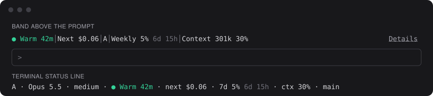

# Vitals

**The session's vital signs for Claude Code**, in one row above the prompt: is the prompt cache still warm, what will the next message cost, how much of your usage limit is left and when it resets, how full the context is and whether now is a good moment to compact. Everything else is one click away in a side pane.

[](CHANGELOG.md)
[](LICENSE)
[](https://github.com/anthropics/claude-code)



Works in the terminal and in the Claude Code desktop app. With Keep Warm off (the default) it never calls a model and costs nothing to run: it reads the figures Claude Code and the API already report. Nothing leaves your machine.

## Why

Claude Code bills and limits you by what it re-sends, and most of that is the context. Whether the next message reads it from the prompt cache (cheap) or writes it again (12 to 20 times the price of a read) depends on how long you have been away. Claude Code does not show that, nor when a limit resets, nor what a compaction would save. Vitals does, without repeating what Claude Code already shows (model, effort and permission mode are in the desktop footer).

## Install

```bash
claude plugin marketplace add iameryksadowski/vitals-plugin-claude-code
claude plugin install vitals@vitals --scope user
```

Or at the prompt of a Claude Code session: `/plugin marketplace add iameryksadowski/vitals-plugin-claude-code`, then `/plugin install vitals@vitals`. A session that was already open picks it up after a restart.

- **Update:** `claude plugin marketplace update vitals`
- **Remove:** `claude plugin uninstall vitals@vitals`, then `claude plugin marketplace remove vitals`
- **Terminal status line (optional):** see [Status line](#status-line).

Requires Claude Code 2.1.287 or later (plugins with a hooks module, also called mods).

<details>
<summary>Coming from Cache Meter</summary>

Vitals was called Cache Meter until 0.6.0. Run `claude plugin uninstall cache-meter@cachemeter` and `claude plugin marketplace remove cachemeter`, install as above, and point the account's `statusLine` at the new script path. The command is `/vitals` (the old `/cache` went in 0.7.0). Settings start fresh under the new name.

</details>

## What it shows

| Part | Shows |
| --- | --- |
| **Cache** | Warm with the time left (a warning color in the last 10 minutes, last minute on a 5m TTL), or cold with the idle time. After a compaction, or a session that comes back after a restart, it knows the cache is cold. |
| **Next** | What re-sending the context costs while warm (cache read), and in the last minutes what it will cost once cold (cache write). |
| **Account and limits** | Which account the session runs on, when you run more than one (see [Accounts](#accounts)), and percent used with the time to reset for each limit your plan reports (an Ultra plan reports only the weekly one). Warning at 80%, error at 95%. Resets read as `6d 15h`, within a day as `14h 20m`. |
| **Context** | Tokens in the context and their share of the window. |
| **Compact** | A hint, with the reason, only when compacting is worth it. See [Compaction](#compaction). |

As the window narrows, parts drop out strictly by priority: the cache state stays longest, then the account, its main limit and the context, then the next message cost and the compact hint.

## The pane

**Details**, or `/vitals`, opens a side pane with five tabs. `/vitals now`, `/vitals context`, `/vitals cost`, `/vitals timeline` and `/vitals settings` open it on one.

| Tab | Shows |
| --- | --- |
| Now | The prompt cache with its TTL bar, what the next message costs warm and cold, every usage limit, the account (its label with a field to rename it, its id, the e-mail) and the session (mode, output style, folder and branch) |
| Context | How full the context is, auto-compact (on or off, and at what share) with a switch, the compact advice with **Compact Now**, what fills the window (as `/context` counts it, estimated locally; tool schemas loaded on demand and the auto-compact reserve are listed apart, since they take no room) and the heaviest MCP servers, connectors named by their tools |
| Cost | Requests, cache hit rate, tokens read, written and uncached, what caching saved, cold writes paid, the last request, the session total |
| Timeline | The newest first: when each message went and how it opens, who sent it (you, another Claude session, a finished task, a scheduled prompt or the app), how long each reply took with its opening line and tool count, and the breaks after which the cache had gone cold |
| Settings | Where the status line is drawn, Keep Warm, the cold send guard, the compact hint, the Alfred send |

## Compaction

Compacting costs about one pass over the context, so it is cheapest at a break you choose. Vitals suggests it when:

- **the cache has gone cold and the context is large** (over `compactAt`, 50% by default): the next message pays that pass anyway, so compacting first costs about the same and every message after it is smaller;
- **auto-compact is near** (within 10 points of its threshold): better now, at a natural break, than mid-task;
- **auto-compact is off** and the context is over 80%.

Then the band shows `Compact` with the reason.

```
/vitals compact                   compact now, as /compact does (or Compact Now in the pane)
/vitals autocompact on | off      switch Claude Code's own auto-compact, as /config does
```

`compactHint: off` hides the hint.

## Status line

One line with the fields you pick, in the order you pick. By default: account, model with its version, effort, cache, next message cost, the 5-hour and weekly limits with their reset, context share, compact hint and git branch.

| Where | How it is drawn |
| --- | --- |
| Terminal | The account's `statusLine` command runs the plugin's script, which prints the line the plugin wrote for that session. |
| Desktop app | Not drawn by default: the desktop app does not run a `statusLine` command, and the band above the prompt already shows the same. `statusLine: on` (or `/vitals line on`) pins it under the prompt there too. |

To use it in the terminal, add this to the account's `settings.json` (`~/.claude/settings.json`, or the folder `CLAUDE_CONFIG_DIR` points to):

```json
"statusLine": {
  "type": "command",
  "command": "bash \"${CLAUDE_CONFIG_DIR:-$HOME/.claude}/plugins/marketplaces/vitals/bin/statusline.sh\""
}
```

Before the plugin has written a session's line (its first moment, or with the plugin off), the script prints a short line from the status line JSON Claude Code hands it: model, limits, context. The script sends nothing anywhere. It needs `jq` for that fallback; without it, it prints nothing until the plugin's line is there.

## Fields

The band and the status line take the same fields. The band keeps them by priority as the window narrows; the status line shows all of them.

| Field | Shows |
| --- | --- |
| `account` | The account's label, when there is more than one account (see [Accounts](#accounts)) |
| `email` | E-mail of the signed-in account, from its login record. Shown only, never sent |
| `model` | Model with its version (Opus 5.5) |
| `effort` | Reasoning effort |
| `mode` | Permission mode (default, accept edits, plan, auto, bypass) |
| `style` | Output style, when it is not the default |
| `dir`, `branch` | Working folder and git branch |
| `cache` | Prompt cache warm or cold, with time left or idle time |
| `next`, `ifcold` | What the next message costs now, and once the cache is cold |
| `context` | Context tokens and share of the window |
| `compact` | The compact hint, only when it is worth it |
| `hit` | Cache hit rate of the session |
| `5h`, `7d`, `spend` | Usage limits with their reset, each only where your plan reports it |
| `session` | What the session has cost at API list prices |

Aliases work too: `weekly`, `ctx`, `cold`, `cost`, `limits` (all three limits), `cwd`, `git`.

Change them for this account (every later session keeps the choice, over the plugin settings):

```
/vitals fields                    every field and both lists
/vitals line                      the line now, and its fields
/vitals line hide email effort
/vitals line show branch mode
/vitals line set account model 7d context
/vitals line reset                back to the plugin settings
/vitals line on | off | auto      also pin it under the prompt, draw it nowhere, or only in the terminal
/vitals band show account model   the same for the band
```

Or in `/plugin configure vitals@vitals`: `bandFields`, `lineFields`, `statusLine`, `resetStyle`, `accountLabels`.

## Accounts

Most people run Claude Code on one account, and then Vitals leaves the account out: there is nothing to tell apart. If you run several (each in its own config folder through `CLAUDE_CONFIG_DIR`, such as `~/.claude` and `~/.claude-work`), each session shows which one it is on.

An account has two things:

- **ID**: the name of its config folder (`.claude`, `.claude-work`). It tells accounts apart on your machine and never changes.
- **Label**: what the band and the status line show. It is yours to set, and the first of these that exists wins:

| Label | Comes from |
| --- | --- |
| Your own | Type it into **Rename** on the pane's Now tab, or run `/vitals account Work`. Kept for every session on that account; **Reset** or `/vitals account reset` hands it back. |
| From the settings | `accountLabels` in `/plugin configure vitals@vitals`, such as `.claude=Personal, .claude-work=Work` |
| The folder's name | A config folder that carries a name gives it: `~/.claude-work` is Work, `~/.claude-my-team` is My Team |
| A letter | A folder with no name in it: `~/.claude` is A, `~/.claude-b` is B, `~/.claude-2` is 2 |

A rename is kept per account, so every session on it shows the new name. The automatic label stays beside it (the pane shows both, `$.vitals.snapshot()` gives `account.auto`), and Reset brings it back.

`/vitals account` prints the label, where it comes from and the ID.

## Keep Warm

Off by default. Shortly before the cache would expire (5 minutes before on a 1h TTL, 45 seconds on 5m), it forks one tool-less question over the session's own transcript, on the same model and system prompt. The API serves that prefix from the cache, the read starts the TTL over, and nothing is added to the conversation.

Each ping costs one cache read of the context (about $0.03 for 150k tokens on Opus 5.5) instead of a full re-write later (about $1.20). It stops `keepWarmFor` after your last message, and switches itself off if a ping ever finds the cache already gone.

## Cold send guard

Off by default. When the cache has gone cold and the context is over 50k tokens, the first message you send is held once, with its re-cache price. Send it again to go ahead, or `/clear` and start from a summary. Slash commands and prompts nobody typed (task notifications, scheduled prompts, other sessions) are never held. `guard: warn` only shows the price.

## On, off and where

Keep Warm and the cold send guard are each set at three levels. The closer one wins.

| Level | How | Lasts |
| --- | --- | --- |
| Every repo | `/plugin configure vitals@vitals`: `guard`, `keepWarm` | Until you change it |
| This repo | `/vitals guard repo on\|off\|reset`, `/vitals warm repo on\|off\|reset`, or the pane | Every new session in this repo and its worktrees |
| This session | `/vitals guard on\|off`, `/vitals warm on\|off`, or the pane | Until the session ends |

The pane shows which level set each switch. Claude Code reads plugin settings from your user settings only, so the plugin keeps each repo's choice in its own store under your Claude Code configuration, keyed by the repo's folder.

## Settings

All in `/plugin configure vitals@vitals`, stored as `pluginConfigs` in your user settings, so each account keeps its own.

| Setting | Values | Default |
| --- | --- | --- |
| `ttl` | `auto`, `1h`, `5m` | `auto`: 1h on a subscription, 5m on an API key |
| `guard` | `off`, `confirm`, `warn` | `off` |
| `keepWarm` | `off`, `on` | `off` |
| `keepWarmFor` | `1h`, `2h`, `4h`, `8h` | `2h` after your last message |
| `bandFields` | fields, in order | `cache, next, account, 5h, 7d, spend, context, compact` |
| `lineFields` | fields, in order | `account, model, effort, cache, next, 5h, 7d, context, compact, branch` |
| `statusLine` | `auto`, `on`, `off` | `auto`: the terminal script only |
| `resetStyle` | `auto`, `countdown`, `clock`, `both` | `auto`: a countdown, `6d 15h` or `14h 20m` |
| `compactHint` | `on`, `off` | `on` |
| `compactAt` | `30` to `70` | `50`: with a cold cache, the context share from which the hint shows |
| `accountLabels` | `.claude=Personal, .claude-work=Work` | the folder's name or a letter, or nothing with one account |
| `alfred` | `off`, `on` | `off` |
| `alfredHome` | a folder | `~/Development/alfred-app` |
| `alfredUrl` | a URL | `http://127.0.0.1:8765` |

## For plugin authors

Vitals adds `$.vitals` to the engine, so another plugin can read this session's figures instead of measuring them again. List `vitals` under `dependencies` in your `plugin.json`, or check that `$.vitals` is there, and call:

```ts
const s = await $.vitals.snapshot()
// s.account.label, s.account.id, s.cache.state, s.cache.nextUsd, s.context.percent,
// s.context.autoCompactAtPercent, s.context.advice,
// s.limits (kind, percentUsed, resetsAt), s.session.hitPercent, s.session.usd
```

It refreshes every 15 seconds and after each reply, and is `null` before the first. It never carries the e-mail or anything said in the session. Types: `VitalsSnapshot` in [`types/index.d.ts`](types/index.d.ts).

Vitals takes one band row above the prompt (its own), one pane (id `vitals`) and no hotkey, so it sits next to other plugins without clashing.

## Privacy

- Vitals reads what Claude Code hands every plugin: token counts, usage limits, the model, the context breakdown and the account's login record (for the e-mail, which is only shown).
- It writes the status line to `$TMPDIR/vitals/<session>.line` and keeps its settings and each session's last request time in Claude Code's plugin store.
- It sends nothing anywhere unless you turn on the Alfred send below. Keep Warm, when on, talks only to Anthropic, through Claude Code, like any message of yours.

## Alfred (optional)

Alfred is the author's local assistant app. If you do not run it, leave `alfred` off and ignore this section.

With `alfred` on, Vitals sends the session's usage reading to the local Alfred engine (`POST http://127.0.0.1:8765/api/konta/uzycie`, with the local token from `<alfredHome>/data/api.token`) at most once a minute per session: the config folder, the session id, each usage window (percent used and reset), the context window and the model id. Never the e-mail, a credential or anything said in the session. A down engine never holds anything up; the pane says when the last reading went. `alfredHome` and `alfredUrl` (or `ALFRED_URL`) point it elsewhere; `ALFRED_API_TOKEN` adds a bearer token.

## Honest by design

- A model switch makes the cache cold at once, and the next message is priced on the new model.
- A model the price table does not know shows no prices at all, never a guess from a neighbouring model.
- The TTL is the one the engine reports when it reports one; the `ttl` setting wins when set by hand.
- A usage limit past its reset time says "Just reset" until the next reply brings the new figure.
- After a restart the last known limits stay until the API reports new ones, so a subscription keeps its 1h TTL and its prices.
- The hit rate rounds down: it never shows 100% unless every token was read from cache.
- Not visible to Vitals: a side chat or another tool that reads the same cache. Then the real cache can be warmer than shown, never colder.

## Good to know

- Dollar figures are API list prices from [`hooks/cache.ts`](hooks/cache.ts). On a subscription they show how heavy a message is against your limits, not a bill.
- Each account (config folder) reads its own login record, limits and settings, so the line never shows another account's figures.
- Only the main thread resets the cache clock; subagents have their own caches.
- What Claude Code does not hand a plugin, Vitals does not show: fast mode has no reading for plugins yet.
- The plugin API is in early access: after a Claude Code update, run the checks below.

## Develop

```bash
claude --plugin-dir .          # run Claude Code with this folder loaded
claude plugin validate .       # what the module hooks and adds to $, and anything the engine would refuse
claude plugin test .           # the tests in tests/
```

Loading the folder once writes the API types to `.claude-plugin/types/` (ignored by git), so `tsc -p .` type-checks the module. Issues and pull requests are welcome; see [CHANGELOG.md](CHANGELOG.md) for what changed.

## License

[MIT](LICENSE) © 2026 Eryk Sadowski

---

Made by [Eryk Sadowski](https://eryksadowski.com).
